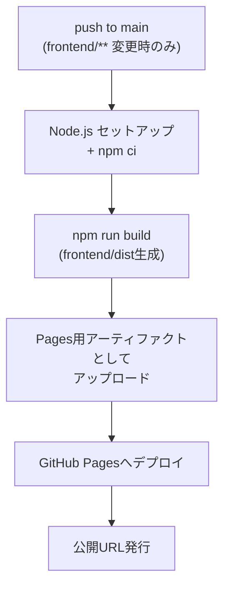

# .github/workflows/ — CI/CD Pipeline
GitHub Actionsを用いてCI/CDを実装しました。
 
# Frontend Deploy — GitHub Pages

`frontend/`配下の変更が`main`にpushされると, GitHub ActionsがVite + Reactアプリをビルドし, GitHub Pagesへ自動デプロイします。バックエンドのデプロイ(SSM経由)とは完全に独立したワークフローです。

## デプロイ流れ



## トリガー条件

`frontend/**`以下のファイルが変更されたpushのみでワークフローが起動します。バックエンドのみの変更ではこのワークフローは動作しません。

```yaml
on:
  push:
    branches: [main]
    paths:
      - 'frontend/**'
  workflow_dispatch:
```

## 事前設定 — Pages Source

このワークフローが機能するには, リポジトリの **Settings → Pages → Build and deployment → Source** を **"GitHub Actions"** に設定する必要があります(デフォルトの"Deploy from a branch"のままでは動作しません)。

## Base Path設定

GitHub Pagesは`https://<username>.github.io/<repo-name>/`というサブパス配下で公開されるため, `frontend/vite.config.ts`で`base`をリポジトリ名に合わせて明示的に指定しています。指定を忘れるとビルド後のアセットパスが崩れ, 白画面になります。

```ts
export default defineConfig({
  plugins: [react()],
  base: '/repo-name/',
})
```

## バックエンドとの接続

フロントエンド(GitHub Pages)とバックエンドAPI(EC2上のHonoサーバー)は異なるoriginとなるため, バックエンド側でCORS設定が必要です(詳細は`src/README.md`参照)。

### Deployment
There is no push-based deployment. The instance is created with `./scripts/up.sh`, and its bootstrap script clones `main`, builds, and starts the server with pm2, so booting an instance deploys the latest `main`. This also keeps AWS credentials out of GitHub.